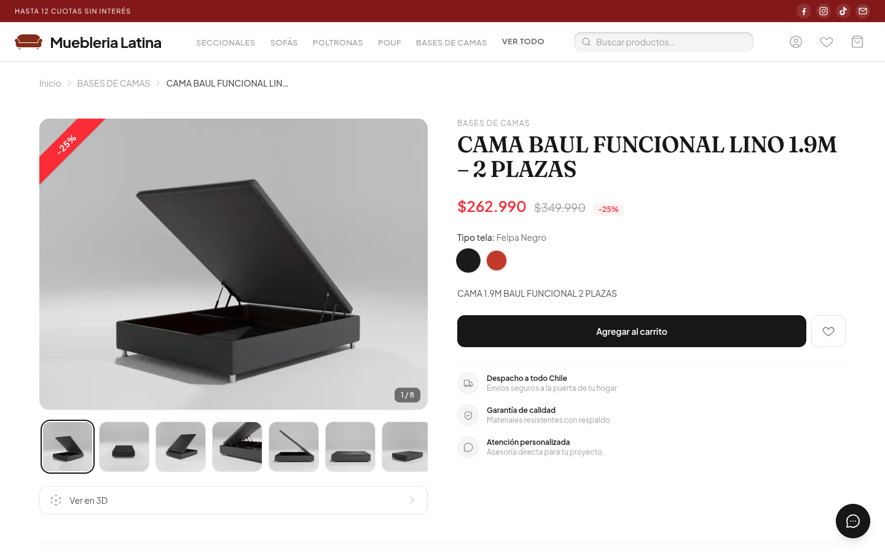
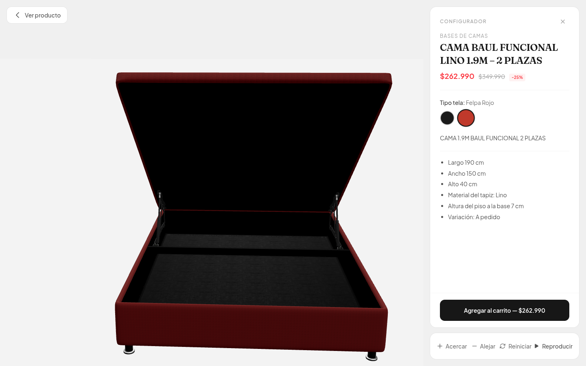
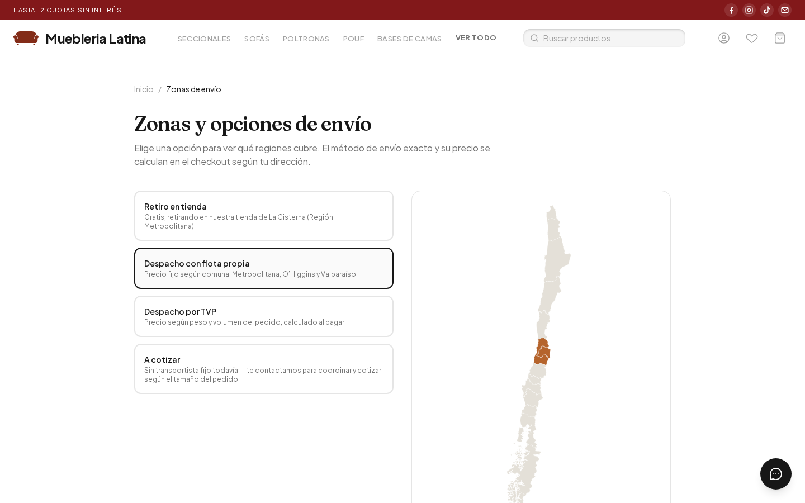
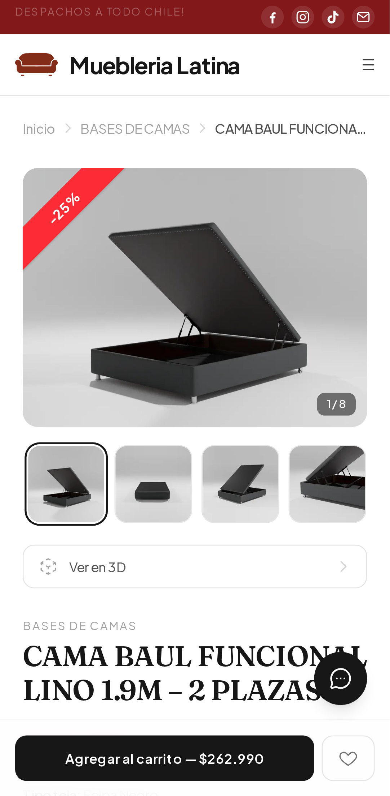
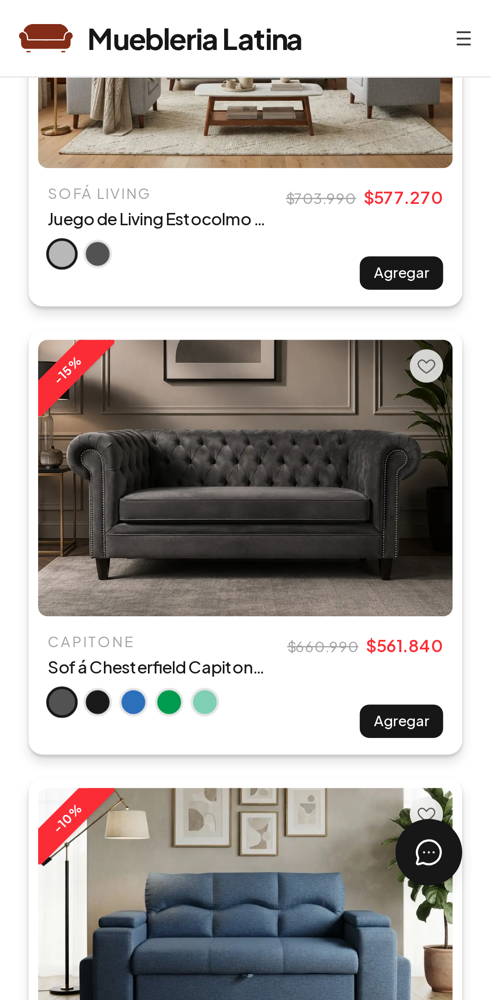

# Mueblería Latina

**Tienda online de muebles tapizados con configurador 3D, sobre WooCommerce headless.**

Frontend propio en Next.js para una fábrica de muebles chilena: catálogo,
detalle de producto con variantes de tela, visor 3D con cambio de color en
vivo y un checkout completo con despacho calculado por comuna y pago con
Webpay. WooCommerce se usa solo como backend (productos, stock, pedidos), y la
tienda entera vive en el frontend.

🔗 **Sitio en producción:** [www.mueblerialatina.cl](https://www.mueblerialatina.cl)

> El código fuente es privado (proyecto comercial en producción).
> Si quieres revisarlo en el contexto de un proceso de selección, escríbeme y
> te doy acceso.

---

## Por qué existe

La tienda anterior era un WordPress con un tema genérico: lento, difícil de
adaptar y sin forma de mostrar las telas disponibles de cada mueble. El
objetivo era una experiencia de compra a la medida del negocio, con
variantes de tela visuales, vista 3D, despacho real por comuna y un panel que
el equipo pueda manejar sin tocar código, **sin migrar el catálogo, los
pedidos ni el flujo de pago** que ya funcionaban en WooCommerce.

## Funcionalidades

| | |
|---|---|
| **Catálogo headless** | Categorías, subcategorías con navegación sticky, búsqueda con debounce y catálogo completo, todo servido desde la Store API de WooCommerce con SSR |
| **Variantes de tela** | Selector multi-atributo con disponibilidad cruzada; la card del grid cambia imagen, precio y descuento según el color elegido |
| **Configurador 3D** | Visor a pantalla completa con three.js: tintado por color, texturas PBR, animaciones (ej. abrir el baúl de una cama) y modelos comprimidos con Draco |
| **Checkout propio** | Retiro en tienda o despacho: flota propia por comuna, transportista por peso y volumen, o a cotizar. Dirección con Google Places, pago con Webpay Plus o transferencia |
| **Campañas de venta** | CyberDay y similares: curaduría de productos, color y banner propios, descuento en lote que se aplica y revierte solo según las fechas |
| **Cuenta de cliente** | Registro, login, recuperación de contraseña, historial de pedidos y lista de deseos persistida por cuenta |
| **Reseñas** | Calificación y reseñas con moderación e insignia de "Compra verificada" |
| **Panel administrable** | Hero de la home (imagen o video), barra de anuncios, botones flotantes, datos de transferencia y campañas, editables desde wp-admin |
| **SEO** | Open Graph, JSON-LD (`Product`, `BreadcrumbList`, `Organization`), sitemap, canonical y 123 redirecciones del sitio anterior |

| Detalle de producto | Configurador 3D |
|---|---|
|  |  |

| Catálogo | Zonas de envío |
|---|---|
|  |  |

| Mobile | |
|---|---|
|  |  |

## Stack

- **Next.js 16 (App Router) + React 19 + TypeScript**
- **Tailwind CSS v4**
- **three.js + react-three-fiber + drei**, cargados bajo demanda solo en el configurador
- **WooCommerce Store API v1** como backend, con un proxy propio en rutas de Next.js
- **~20 plugins propios de WordPress en PHP** para lo que la Store API no expone: autenticación de clientes, cálculo de envío, campañas, configuración 3D, reseñas, correo SMTP, etc.
- **Webpay Plus (Transbank)** para pagos, **Google Maps Places** para direcciones
- **Playwright** para tests end-to-end en desktop y mobile, incluido un pago real de punta a punta contra el ambiente de integración de Transbank
- Desplegado en servidor propio con **Coolify**, detrás de **Cloudflare**

## Desafíos técnicos destacados

- **Pago headless con Webpay.** El plugin de Transbank está pensado para el
  checkout nativo de WordPress. El pedido se crea desde el frontend vía Store
  API, y un plugin propio intercepta la vuelta desde Webpay para devolver al
  cliente a la confirmación de Next.js con lo necesario para mostrar el
  resumen sin sesión, también para compras de invitado. Un hallazgo real:
  WooCommerce solo confirma el pago cuando el navegador completa esa vuelta,
  así que el dominio del frontend pasó a ser parte crítica del flujo de pago.
- **Precios que no se pueden manipular.** El cliente solo envía IDs y
  cantidades, y todo precio, descuento y envío se recalcula en el servidor.
  Lo verifiqué intentando atacar el checkout con precios alterados.
- **Envío por comuna y peso efectivo.** El costo depende del método, la
  comuna y el peso o volumen de cada bulto (un sofá puede venir en varios).
  En el checkout, escribir rápido la dirección disparaba actualizaciones
  concurrentes que chocaban con el nonce de sesión de WooCommerce y
  terminaban en 401. Lo encontró el primer test end-to-end y se resolvió con
  un debounce.
- **Bugs que solo existen en producción.** La Content-Security-Policy solo se
  aplica en el build de producción. Bloqueaba Google Maps y, en el
  configurador, las texturas `blob:` y el Web Worker del decoder Draco.
  Ninguna prueba en `dev` podía verlo. Desde entonces, todo cambio de
  cabeceras se valida contra un build de producción real.
- **Campañas sobre precios nativos.** El descuento en lote escribe el precio
  de oferta nativo de WooCommerce, así que carrito, pedido y correos lo
  respetan sin lógica extra. Si un producto ya tenía su propia oferta, se
  guarda y se restaura al terminar la campaña, ya sea porque se cerró a mano
  o por un evento programado en la fecha de término.
- **Migración de dominio sin perder posicionamiento.** El sitio anterior tenía
  su historial en Google en otro dominio. Sus 123 URLs redirigen de forma
  permanente, en un solo salto, a su equivalente nuevo, sin cadenas por la barra
  final, junto con el traslado del DNS a Cloudflare y del correo a un
  proveedor nuevo.
- **Imágenes de un hosting inestable.** Las imágenes vienen de un backend que
  falla de forma intermitente, así que todas pasan por un componente con
  reintento automático. Los cambios de variante funden la imagen nueva sobre
  la anterior recién cuando terminó de cargar.

## Estado

En producción desde septiembre de 2026, con Webpay operando con las credenciales reales del comercio.

---

**Joaquín Contreras** · [LinkedIn](https://www.linkedin.com/in/joaquin-contreras-pino/) · [Email](mailto:joaquin.contreras.dp@gmail.com)

© 2026 Joaquín Contreras. Todos los derechos reservados.
